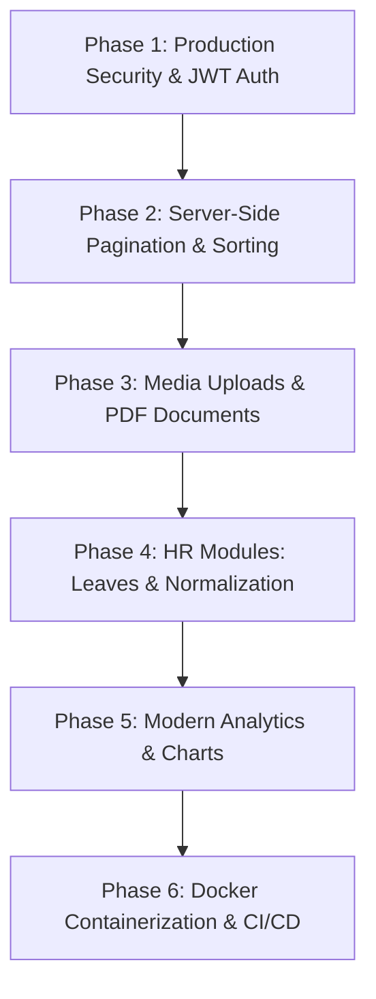

# Project Handover & Future Enhancement Roadmap
## Employee Database – Employee Management System (EMS Pro)

**Document Version:** 1.0.0  
**Author / Original Developer:** Sanskar Bhoir  
**Target Audience:** Incoming Engineering Team / Next Phase Developers  
**GitHub Repository:** [https://github.com/SanskarBhoir7/EmployeeManagementSystem.git](https://github.com/SanskarBhoir7/EmployeeManagementSystem.git)  

---

## 1. Executive Summary & Project Status

This document serves as the official technical handover guide for the **Employee Database – Employee Management System (EMS Pro)**. The system is currently in a **fully stable, production-ready baseline state** conforming to a clean four-tier monolithic architecture:

$$\text{Bootstrap 5 / Vanilla JS Frontend} \longleftrightarrow \text{Spring Boot 3 REST Controllers} \longleftrightarrow \text{Service Layer} \longleftrightarrow \text{Spring Data JPA / Hibernate} \longleftrightarrow \text{MySQL 8.0}$$

### Current Baseline Metrics:
- **Build Status:** Stable build (`mvn clean compile` succeeds with zero errors on JDK 21/25).
- **Test Suite:** 17 automated tests (8 unit tests in Mockito + 9 integration tests in `MockMvc`) with a 100% pass rate.
- **Database:** Auto-configured schema on MySQL 8.0 with HikariCP connection pooling and automatic sample data seeding (10 realistic employee records).
- **Default Port:** Runs on `8081` (configurable in `application.properties`).

---

## 2. Codebase Orientation & Architecture Overview

Incoming developers should familiarize themselves with the following directory structure:

```text
IP-EmployeeDatabaseProject/
├── backend/
│   ├── src/main/java/com/example/employee/
│   │   ├── EmployeeApplication.java           # Main application entry point
│   │   ├── config/
│   │   │   ├── DataInitializer.java           # CommandLineRunner: Seeds 10 sample employees
│   │   │   └── WebConfig.java                 # CORS (/**) & static resource mappings
│   │   ├── controller/
│   │   │   └── EmployeeController.java         # REST endpoints (9 implemented APIs)
│   │   ├── dto/
│   │   │   ├── ApiResponse.java               # Standard API response wrapper
│   │   │   ├── EmployeeRequestDto.java        # Input DTO with Bean Validation
│   │   │   ├── EmployeeResponseDto.java       # Output representation DTO
│   │   │   └── ErrorResponse.java             # Standardized error payload
│   │   ├── entity/
│   │   │   └── Employee.java                  # JPA entity with table constraints & lifecycle hooks
│   │   ├── exception/
│   │   │   ├── DuplicateEmailException.java   # HTTP 409 conflict trigger
│   │   │   ├── EmployeeNotFoundException.java # HTTP 404 not found trigger
│   │   │   └── GlobalExceptionHandler.java    # @RestControllerAdvice centralized error handler
│   │   ├── repository/
│   │   │   └── EmployeeRepository.java        # Spring Data JPA interface with custom JPQL
│   │   └── service/
│   │       ├── EmployeeService.java           # Business logic contract
│   │       └── impl/
│   │           └── EmployeeServiceImpl.java   # Transactional service implementation
│   ├── src/main/resources/
│   │   ├── application.properties             # Database credentials & port configuration
│   │   └── static/                            # Direct frontend build delivered by Spring Boot
│   ├── src/test/java/                         # Unit and MockMvc test suites
│   └── pom.xml                                # Maven build descriptors
├── frontend/                                  # Standalone copy of HTML/CSS/JS frontend
│   ├── index.html                             # Dashboard with metric cards & table
│   ├── employees.html                         # Personnel directory
│   ├── add-employee.html                      # Add/Edit form with dual-mode validation
│   ├── css/style.css                          # Custom CSS design system & Bootstrap tokens
│   └── js/app.js                              # Asynchronous Fetch API client & UI controller
├── database/
│   ├── schema.sql                             # DDL table creation script
│   └── data.sql                               # Initial sample seed insert script
├── README.md                                  # Setup & user documentation
└── start-backend.bat                          # One-click Windows development launcher
```

---

## 3. What Is Already Implemented & Working

Before planning additions, note that the following features are **fully functional**:

1. **Full Employee CRUD Operations:**
   - Registration via `POST /api/employees` with duplicate email validation.
   - Listing via `GET /api/employees` and single lookup via `GET /api/employees/{id}`.
   - Updating via `PUT /api/employees/{id}` with cross-employee duplicate check exclusion (`existsByEmailAndIdNot`).
   - Deletion via `DELETE /api/employees/{id}` with frontend modal confirmation.
2. **Search & Multi-Filter Querying:**
   - Real-time debounced search by first name, last name, email, or designation via `GET /api/employees/search?name={q}`.
   - Department filtering via `GET /api/employees/department/{department}`.
   - Status filtering via `GET /api/employees/status/{status}`.
   - Combined multi-parameter filtering via `GET /api/employees?department=...&status=...`.
3. **Data Integrity & Two-Tier Validation:**
   - Client-side validation: HTML5 form validation with instant visual feedback.
   - Server-side validation: Jakarta Bean Validation (`@NotBlank`, `@Email`, `@Positive`, `@NotNull`).
   - Relational database constraints: Primary key, `uk_employee_email` unique index, positive salary check constraint.
4. **Exception Handling:**
   - Centralized `@RestControllerAdvice` mapping exceptions to standard JSON responses with HTTP status codes: 400 (Bad Request), 404 (Not Found), 409 (Conflict), and 500 (Internal Server Error).
5. **Dashboard & UI Elements:**
   - Live metrics: Total Employees, Active Personnel, Inactive Personnel, and Department count.
   - Modal profile card displaying full residential address, joining date, and formatted salary in INR (`₹`).
   - Single-click CSV export utility.
   - UI-level role toggle simulating **ADMIN** (full access) vs **HR** (delete button locked).

---

## 4. Enhancement Roadmap (Categorized & Prioritized)

The following enhancement modules represent natural extensions for the incoming development team, ordered by business priority:



---

### Phase 1: Production Security & Authentication (High Priority)
*Currently, role switching (ADMIN vs HR) is handled on the client side. The primary next step is integrating enterprise server-side authentication.*

1. **Spring Security 6 Integration:**
   - Add `spring-boot-starter-security` to `pom.xml`.
   - Implement stateless JSON Web Token (JWT) token-based authentication.
2. **User & Role Entity Modeling:**
   - Create `User` entity (`id`, `username`, `password_hash`, `email`, `role`, `enabled`, `created_at`).
   - Store passwords hashed using `BCryptPasswordEncoder`.
   - Roles: `ROLE_ADMIN`, `ROLE_HR`, `ROLE_EMPLOYEE`.
3. **Authentication Endpoints:**
   - `POST /api/auth/register`: Create administrative accounts.
   - `POST /api/auth/login`: Authenticate credentials and return `{ token, type: "Bearer", role, username }`.
   - `POST /api/auth/refresh`: Refresh expired JWT access tokens.
4. **Endpoint Route Security:**
   - Annotate service/controller endpoints using `@PreAuthorize`:
     - View & Search: Accessible by `HR` and `ADMIN`.
     - Create & Update: Accessible by `HR` and `ADMIN`.
     - Delete: Restricted strictly to `ROLE_ADMIN`.

---

### Phase 2: Scalability, Pagination & Advanced Filtering (High Priority)
*Currently, `GET /api/employees` returns all records in a single payload. As the organization grows past hundreds of employees, database pagination is essential.*

1. **Spring Data Pageable & Sort:**
   - Modify repository and service to accept `org.springframework.data.domain.Pageable`.
   - Endpoint signature:
     ```java
     @GetMapping
     public ResponseEntity<Page<EmployeeResponseDto>> getAllEmployees(
         @RequestParam(defaultValue = "0") int page,
         @RequestParam(defaultValue = "10") int size,
         @RequestParam(defaultValue = "id") String sortBy,
         @RequestParam(defaultValue = "asc") String sortDirection,
         @RequestParam(required = false) String department,
         @RequestParam(required = false) String status)
     ```
2. **Frontend Pagination Component:**
   - Add pagination controls below the dashboard table showing current page number, total pages, page size selector (10, 25, 50, 100), and Next/Previous navigation buttons.
3. **Date-Range Filtering:**
   - Add filters for employee joining dates (e.g. joined between `startDate` and `endDate`) using Spring Data JPA Specifications.

---

### Phase 3: Media Uploads, Document Generation & Bulk Import (Medium Priority)

1. **Employee Profile Photo Uploads:**
   - Add `avatarUrl` or `photoPath` column to `employees` table.
   - Implement `POST /api/employees/{id}/avatar` accepting `MultipartFile`.
   - Validate file types (`image/jpeg`, `image/png`), file size limit ($\le 2$ MB), and store on disk (`/uploads/avatars/`) or Amazon S3 / GCP Cloud Storage.
2. **Salary Slip Generation (PDF):**
   - Add dependency: `com.github.librepdf:openpdf` or `org.apache.pdfbox:pdfbox`.
   - Implement `GET /api/employees/{id}/salary-slip?month=...&year=...`.
   - Generate official PDF with company letterhead, employee designations, salary deductions, and net payout.
3. **Bulk Excel/CSV Import via Apache POI:**
   - Add `org.apache.poi:poi-ooxml`.
   - Implement `POST /api/employees/import` accepting `.xlsx` or `.csv` spreadsheets to import hundreds of employee records in a single batch operation.

---

### Phase 4: Extended HR Management Modules (Medium Priority)

1. **Normalized Department & Designation Master Tables:**
   - Replace flat `department` and `designation` strings with relational tables:
     - `departments` (`id`, `name`, `code`, `head_of_department_id`, `budget`).
     - `designations` (`id`, `title`, `grade_level`, `min_salary`, `max_salary`).
   - Use JPA `@ManyToOne` relationships in `Employee`.
2. **Leave & Attendance Management:**
   - Entity: `LeaveRequest` (`id`, `employee_id`, `leave_type`, `start_date`, `end_date`, `reason`, `status: PENDING/APPROVED/REJECTED`, `approved_by`).
   - Implement manager approval workflows.
3. **Audit Trail & Compensation History:**
   - Entity: `SalaryRevision` (`id`, `employee_id`, `old_salary`, `new_salary`, `effective_date`, `remarks`, `revised_by`).
   - Or configure Hibernate Envers (`@Audited`) for automatic historical entity revision logging.

---

### Phase 5: UI Modernization & Analytics Dashboard (Medium-Low Priority)

1. **Visual Chart Integration:**
   - Integrate [Chart.js](https://www.chartjs.org/) or [ApexCharts](https://apexcharts.com/) on `index.html`.
   - Visualizations:
     - Donut chart: Headcount distribution by Department.
     - Bar chart: Monthly salary expenditure per Department.
     - Gauge: Active vs Inactive personnel ratio.
2. **Dark Mode Theme:**
   - Add a theme toggle saving preference to `localStorage`.
   - Implement CSS variables for dark background (`#0f172a`), dark cards (`#1e293b`), and light text (`#f8fafc`).
3. **Optional SPA Migration:**
   - If desired, migrate the frontend from Vanilla JS to React, Angular, or Vue.js while keeping the Spring Boot REST API completely unchanged.

---

### Phase 6: DevOps, Cloud Deployment & API Documentation (High for Production)

1. **Swagger / OpenAPI 3 Documentation:**
   - Add dependency to `backend/pom.xml`:
     ```xml
     <dependency>
         <groupId>org.springdoc</groupId>
         <artifactId>springdoc-openapi-starter-webmvc-ui</artifactId>
         <version>2.6.0</version>
     </dependency>
     ```
   - Enables interactive Swagger UI documentation at `http://localhost:8081/swagger-ui.html`.
2. **Dockerization:**
   - Create multi-stage `backend/Dockerfile`:
     ```dockerfile
     FROM maven:3.9.6-eclipse-temurin-21 AS build
     WORKDIR /app
     COPY pom.xml .
     COPY src ./src
     RUN mvn clean package -DskipTests

     FROM eclipse-temurin:21-jre-alpine
     WORKDIR /app
     COPY --from=build /app/target/*.jar app.jar
     EXPOSE 8081
     ENTRYPOINT ["java", "-jar", "app.jar"]
     ```
   - Create root `docker-compose.yml` to spin up both MySQL 8 and Spring Boot with one command:
     ```yaml
     version: '3.8'
     services:
       mysqldb:
         image: mysql:8.0
         environment:
           MYSQL_ROOT_PASSWORD: rootpassword
           MYSQL_DATABASE: employee_db
         ports:
           - "3306:3306"
       app:
         build: ./backend
         ports:
           - "8081:8081"
         depends_on:
           - mysqldb
     ```
3. **CI/CD Pipeline (GitHub Actions):**
   - Create `.github/workflows/ci.yml` that runs `mvn test` automatically on every Pull Request to `main`.

---

## 5. Developer Setup & Getting Started Checklist

To begin working on enhancements, follow these steps:

### Prerequisites:
- JDK 21 or JDK 25 installed (`java -version`).
- Apache Maven 3.8+ installed (`mvn -v`).
- MySQL Server 8.0 running locally on port 3306.

### Setup Instructions:
1. **Clone the repository:**
   ```bash
   git clone https://github.com/SanskarBhoir7/EmployeeManagementSystem.git
   cd EmployeeManagementSystem
   ```
2. **Configure Database Credentials:**
   Open `backend/src/main/resources/application.properties` and verify your local MySQL credentials:
   ```properties
   spring.datasource.url=jdbc:mysql://localhost:3306/employee_db?useSSL=false&serverTimezone=UTC&allowPublicKeyRetrieval=true
   spring.datasource.username=root
   spring.datasource.password=YOUR_MYSQL_PASSWORD
   server.port=8081
   ```
3. **Create the Database:**
   ```sql
   CREATE DATABASE IF NOT EXISTS employee_db;
   ```
4. **Compile and Run Tests:**
   ```bash
   cd backend
   mvn clean test
   ```
   *(Ensure all 17 tests pass before making modifications).*
5. **Start the Application:**
   ```bash
   mvn spring-boot:run
   ```
   *(Or double-click `start-backend.bat` in the project root).*
6. **Access Application:**
   - Dashboard: `http://localhost:8081/index.html`
   - API: `http://localhost:8081/api/employees`

---

## 6. Coding Standards & Contribution Guidelines

1. **Layered Decoupling:** Keep business logic inside `EmployeeServiceImpl`. Controllers should only validate requests and return `ResponseEntity`. Never put SQL queries or transaction logic inside controllers.
2. **DTO Discipline:** Do not expose the internal `Employee` entity directly in REST responses. Always use `EmployeeRequestDto` for input and `EmployeeResponseDto` for output.
3. **Validation First:** Any new field added to `Employee` must have corresponding validation in `EmployeeRequestDto` and database constraints.
4. **Automated Testing Requirement:** For any new endpoint or business rule added, add corresponding unit tests in `EmployeeServiceTest` and `MockMvc` tests in `EmployeeControllerTest`.
5. **Git Commit Convention:**
   - `feat: add jwt authentication and user entity`
   - `fix: resolve pagination offset calculation error`
   - `docs: update api endpoint table in readme`
   - `test: add unit test for leave request submission`

---

*This concludes the project handover documentation. For any architectural clarifications, refer to `README.md` and the existing JUnit test suites in `backend/src/test/`.*
